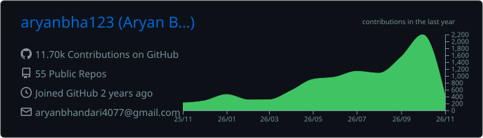
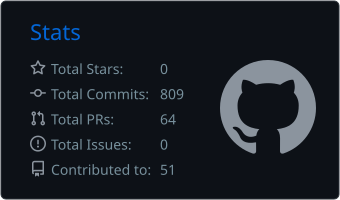
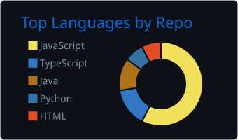
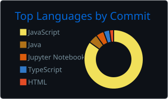

<h1 align="center">Hi 👋, I'm Aryan Bhandari</h1>
<h3 align="center">Backend-Focused SDE | Scalable Systems | MERN + DevOps</h3>

  

  
  
  
  

  
  

---

## ⚡ What I Do

- 🚀 Build scalable backend systems (**1000+ concurrent users**)
- ⚡ Optimize APIs (**800ms → 50ms** using Redis & caching)
- 📨 Design message-driven architectures with **RabbitMQ & BullMQ**
- ☁️ Deploy production-ready systems on **AWS** with auto-scaling
- 🧠 Solve complex DSA problems (**350+ LeetCode**)

---

## 🔧 Tech Stack

**Languages**

**Backend & Systems**

**Frontend**

**DevOps & Cloud**

**Core CS:** DSA · System Design · Operating Systems · DBMS · Computer Networks

---

## 💼 Highlight Work

### 🚀 BinaryKeeda (Founding Engineer)

- Reduced API latency from **800ms → 50ms** using Redis caching
- Designed a **message-driven architecture** using RabbitMQ & BullMQ
- Deployed a scalable backend on AWS with auto-scaling
- Handled **1000+ concurrent users** with stable performance

---

## 🧩 Featured Projects

> Ordered best-first. Every repo has a full README with setup steps.

| # | Project | What it is | Stack |
|---|---|---|---|
| 1 | 🤖 [**pr-review-bot**](https://github.com/aryanbha123/pr-review-bot) | Local AI PR reviewer for macOS: Claude Code, Codex or Gemini CLI reviews every new PR and push, posts comments, with a localhost dashboard | Shell · GitHub CLI · launchd |
| 2 | 🎟️ [**Spring Boot Booking API**](https://github.com/aryanbha123/spring-boot-booking-app) | Booking service with per-user rate limiting (Bucket4j) and a RabbitMQ queue + worker for async processing | Java · Spring Boot · RabbitMQ · Docker |
| 3 | 🐹 [**Go CRUD API**](https://github.com/aryanbha123/go-crud-api) | Layered REST API (routes → handlers → services → repository) with bcrypt hashing | Go · Gin · PostgreSQL (pgx) · Docker |
| 4 | 🩺 [**Disease Prediction System**](https://github.com/aryanbha123/Disease-Prediction-System) | Symptom chatbot where SVM + Random Forest + Naive Bayes vote (**92% accuracy**), Gemini writes the reply, plus a lifestyle-risk model | Python · scikit-learn · Flask · React |
| 5 | 🌱 [**Eco Bloom**](https://github.com/aryanbha123/ECO-BLOOM) | Plantation-drive & donation platform: Express microservices behind an API gateway, Stripe donations, admin analytics | Node.js · Microservices · Stripe · React |
| 6 | 📊 [**Graph Visualiser**](https://github.com/aryanbha123/Graph-Visualiser) | Build a graph, run BFS, DFS, Prim's or Dijkstra (Java) through an Express server and watch it animate | React · vis-network · Node.js · Java |
| 7 | 🗺️ [**Distance Calculator**](https://github.com/aryanbha123/Distance-Calculator) | Compares Ant Colony Optimisation, A* and Beam Search (C++) on 14 Dehradun landmarks | C++ · Node.js · React |
| 8 | 📍 [**Geo-Attend**](https://github.com/aryanbha123/Geo-Attend-Frontend) | Geofenced attendance with face check-in | React · face-api.js · Express · MongoDB |
| 9 | 👵 [**Elderly Care**](https://github.com/aryanbha123/Elderly-Care) | Family, doctor and caregiver dashboards with JWT auth and real-time Socket.IO chat | MERN · Socket.IO |
| 10 | 📝 [**Assessment Platform Backend**](https://github.com/aryanbha123/assessment-platform-backend) | Assessment API with a BullMQ grading worker and a mail cron | Node.js · BullMQ · Redis · MongoDB |
| 11 | 🏔️ [**Nag Tibba Treks**](https://github.com/aryanbha123/nagtibba-trek) | SEO-first Next.js rebuild of a trekking business site: JSON-LD, sitemap, Open Graph | Next.js 15 · TypeScript |
| 12 | 🏫 [**Tons Valley Education**](https://github.com/aryanbha123/tons-valley-education) | Client school website with an admin panel for gallery and newsletters | MERN · Cloudinary · JWT |

<b>More projects</b>

- 💬 [angular-postapp](https://github.com/aryanbha123/angular-postapp): Angular posts & comments app
- 📝 [bloggy](https://github.com/aryanbha123/bloggy): "Bloggy" blog app (React 19 + TS, Express, MongoDB)
- 🏠 [Urban-Nest](https://github.com/aryanbha123/Urban-Nest): real-estate listings with filters
- 📚 [StudySphere-Client](https://github.com/aryanbha123/StudySphere-Client) + [backend](https://github.com/aryanbha123/studysphere-backend): AI study assistant, notes, quiz bank, code playground
- 🎓 [Techease-Frontend](https://github.com/aryanbha123/Techease-Frontend) + [backend](https://github.com/aryanbha123/Techease-Backend): quiz portal with AI quiz generation
- 💰 [finance-management](https://github.com/aryanbha123/finance-management): Java Swing + PostgreSQL expense tracker with charts
- 🧮 [DSA-Java](https://github.com/aryanbha123/DSA-Java) · [neetcode-submissions](https://github.com/aryanbha123/neetcode-submissions-fwh5x9yp) · [upes-100days-dsa](https://github.com/aryanbha123/upes-100days-dsa): DSA practice

  

---

## 📊 GitHub Stats

  

  
  

  
  

  

---

## 🧠 LeetCode

  

---

  <i>Think deep. Build scalable. Learn continuously.</i>

